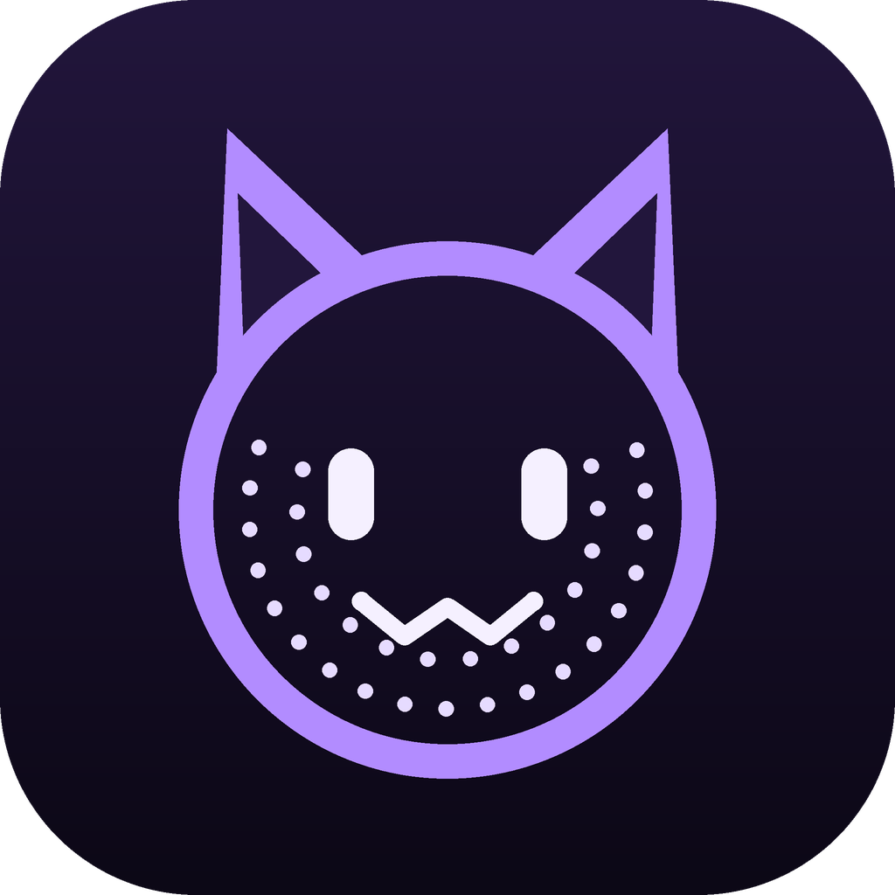

<p align="center"></p>

# VRC Openface

Webcam face tracking for VRChat, written in Rust. VRC Openface runs Google's MediaPipe
face landmarker on ONNX Runtime (CPU or DirectML GPU), maps the 52 blendshapes to
[VRCFaceTracking](https://github.com/benaclejames/VRCFaceTracking) Unified Expressions
and sends them to VRChat over OSC. It needs no VRCFaceTracking install, no Python and no
OpenCV.

## Features

- **Tracking**: MediaPipe face detection, 478-point face mesh and 52 blendshapes at the
  camera frame rate, with optional DirectML GPU inference and automatic CPU fallback.
- **Smooth output**: OSC is sent at 100 Hz, blending between camera frames so the
  avatar moves continuously instead of stepping at 30 FPS. Values go out as OSC bundles,
  so every bit of a binary-encoded parameter changes in the same VRChat frame.
- **116 Unified Expressions parameters**: base shapes plus the v2 blends (`EyeLid`,
  `BrowExpression`, `SmileFrown`, `SmileSad`, `JawX`, `MouthX`, eye gaze, …). It has a
  geometric (mesh) frown estimate because the model's own frown score rarely moves.
- **Avatar aware**: reads the current avatar's name and parameters from VRChat's
  OSCQuery service, its local avatar config files and `/avatar/change` on the receive
  port. A parameter that exists both as a float and as binary bools
  (`Name1/2/4/8…` + `NameNegative`) gets both: the float for you, the bits for everyone
  else.
- **Per-avatar calibration**: *Capture neutral* (with undo) moves each channel's
  minimum to your resting face, and *Center gaze* stores where straight ahead is. Click
  any channel to set its range, an override value, linked or separate left/right,
  symmetry, smoothing strength and (for frown) the model/mesh source.
- **Smoothing** (One-Euro, global or per channel) and **symmetric face**.
- **Tongue tracking** with an imported ONNX model (see [models/README.md](models/README.md)).
- **Cat ears**: drives `EarLeft` / `EarRight` (v2, -1…1) from your brows. Raised brows
  perk the ears up and lowered brows fold them back. Add those float parameters to
  your avatar to use it.
- **See what drives what**: hover a MediaPipe channel to see the Unified Expressions it
  feeds and the avatar parameters they reach, linked with lines across the three panels
  (and the other way round from an expression or avatar parameter).
- Settings panel: VRChat and receive ports, interface scale, sleep when idle, friendly
  names, updates from GitHub releases, debug performance (latency, memory, timing per
  stage), camera preview blur, processing devices, and erase all app data.
- Color schemes, and English / 日本語 / 한국어.

## Install

Download the latest zip from [Releases](https://github.com/setsumi-vrc/VRC-Openface/releases),
extract it anywhere and run `vrc-openface.exe`. Keep the `models` folder and
`DirectML.dll` next to the executable. Later versions can be installed from
Settings → Updates.

The app needs the Microsoft Visual C++ 2015–2022 Redistributable (x64), which most
Windows PCs already have.

## Using it with VRChat

1. Enable OSC in VRChat: Action menu → Options → OSC → Enabled.
2. Start VRC Openface and pick your camera. The landmark overlay should follow your face.
3. Look straight ahead with a relaxed face and open eyes, then press **Capture neutral**.
   Look straight ahead and press **Center gaze**. Each capture takes about 1.5 seconds and
   is saved for the current avatar.
4. Load an avatar with VRCFaceTracking parameters (`FT/v2/...`). The Avatar panel lists
   every matched parameter; binary ones show their bits.

The **FT** button switches output off: the avatar gets a neutral face and
`EyeTrackingActive` / `LipTrackingActive` go false. When no avatar information is
available, every parameter is sent as an `FT/v2/<Name>` float (Settings can turn this off).

Data lives in `%APPDATA%\VRC-Openface\config` (settings, calibrations, imported models).

## Building

You need Rust 1.95 or newer (required by egui 0.37).

```sh
cargo build --release                         # DirectML GPU support is on by default
cargo build --release --no-default-features   # CPU-only build
```

ONNX Runtime binaries are downloaded by the `ort` crate at build time. Ship
`target/release/vrc-openface.exe` with `target/release/DirectML.dll` and `models/`.

## Development

```sh
cargo test
cargo clippy --all-targets
cargo run --release --example still_image -- path/to/face.jpg   # blendshapes as JSON
cargo run --release --example camera_check -- 0 640 480 30       # camera mode and real FPS
uv run tools/convert_models.py                                   # rebuild models/*.onnx
uv run tools/make_icons.py                                       # rebuild the app icon in assets/
uv run tools/make_link_icons.py                                  # rebuild the GitHub and X marks in assets/
uv run tools/make_flags.py                                       # rebuild the language flags in assets/flags/
```

`VRC_OPENFACE_DATA=<folder>` runs the app with a separate data folder.

## Changes

See [CHANGELOG.md](CHANGELOG.md) for what changed in each version.

## License

The code is MIT licensed. The models in `models/` are Google's MediaPipe models
(Apache 2.0); see [models/README.md](models/README.md).
